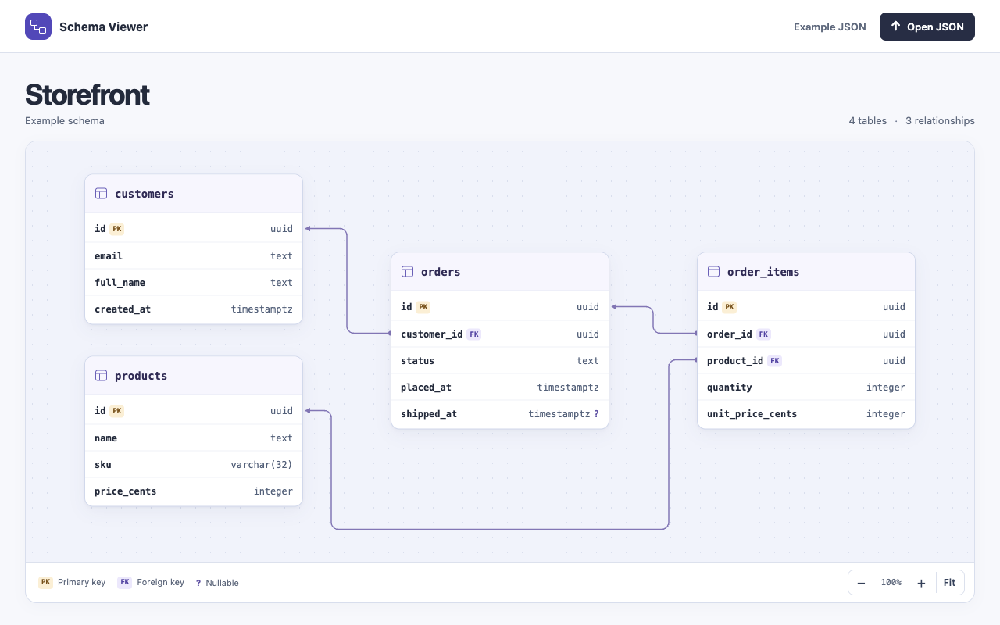

# Schema Viewer

A standalone HTML viewer for database schemas. Load a JSON file to inspect tables, column types, and foreign-key connections.

## Run locally

Save a copy of index.html and open it in your browser. The Storefront example loads automatically. The viewer needs no server, dependencies, or database credentials. [Get index.html](index.html)

Choose **Open JSON** to view your own schema, or download **Example JSON** from the page to use as a starting point.

## Explore the diagram

- Drag the background to pan, or focus the diagram and use the arrow keys.
- Scroll up or down over the diagram to zoom around your pointer. You can also use **−** and **+**. **Fit** brings the whole schema into view.
- Select a table header to highlight its foreign-key connections. Arrows point to the referenced columns. Click the background or press **Esc** to clear the highlight.

## JSON format

Start with [example.json](example.json) or use this smaller example.

~~~json
{
  "name": "Storefront",
  "tables": [
    {
      "name": "customers",
      "columns": [
        { "name": "id", "type": "uuid", "primaryKey": true }
      ]
    },
    {
      "name": "orders",
      "columns": [
        { "name": "id", "type": "uuid", "primaryKey": true },
        {
          "name": "customer_id",
          "type": "uuid",
          "references": { "table": "customers", "column": "id" }
        },
        { "name": "shipped_at", "type": "timestamptz", "nullable": true }
      ]
    }
  ]
}
~~~

| Field | Format |
| --- | --- |
| `name` | Optional schema name. The viewer uses the filename when omitted. |
| `tables` | Required array. Each table has a unique string `name` and a `columns` array. Use names such as `public.customers` to distinguish database namespaces. |
| `columns` | Each column has a string `name` unique within its table and a string `type` such as `uuid` or `numeric(10,2)`. |
| `primaryKey` | Set to `true` to show the PK badge. |
| `nullable` | Set to `true` to mark a column as nullable. |
| `references` | Set on the source column with the target `table` and `column` names. Both names must match entries in the file. |

The viewer draws one arrow for each `references` entry. An invalid file displays an error above the diagram and keeps the current schema visible.
